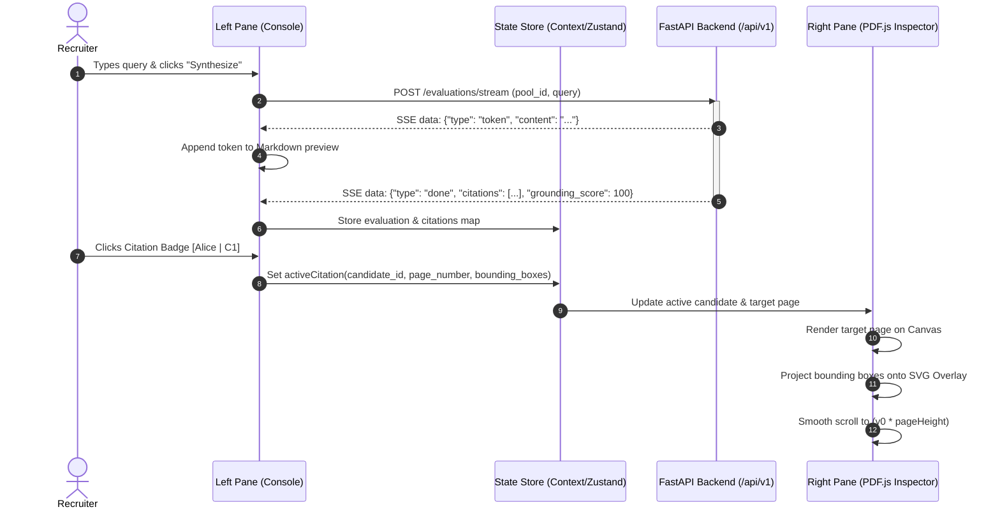

# Milestone 5: Next.js Dual-Pane Recruiter Console & Grounded PDF Inspector

## 1. Executive Summary & Objective

In **Milestones 1 through 4**, we engineered and validated the entire backend engine of the **Multi-Candidate Semantic Talent Engine**:
1. **Milestone 1:** High-concurrency Supabase PostgreSQL schema with `pgvector` HNSW index.
2. **Milestone 2:** PyMuPDF C-accelerated text extraction with normalized $[0.0, 1.0]$ bounding box tracking and two-way sentence-snapped chunking.
3. **Milestone 3:** Google `gemini-embedding-2` 768-dimensional Matryoshka embeddings and diversity-capped vector similarity search.
4. **Milestone 4:** Grounded comparative candidate evaluation via `gemini-4-hydrogen`, Server-Sent Events (SSE) token streaming, and the `CitationVerifier` anti-hallucination engine.

**Milestone 5** brings this engine to life for recruiters through the **Dual-Pane Recruiter Console**:
A split-screen, reactive web application built with **Next.js 14+ (App Router)**, **TypeScript**, and **Tailwind CSS**. 

The cornerstone feature of this milestone is **Zero-Latency Grounded Evidence Synchronization**:
When an executive recruiter reads a comparative synthesis in the left pane and encounters a claim backed by a citation badge—such as `[Candidate: Alice Architect | Chunk: C1]`—clicking that badge instantly shifts the right pane to Alice's PDF resume, navigates to the exact page, and paints an animated highlight bounding box over the source sentence.

---

## 2. Dual-Pane System Architecture

```
+------------------------------------------------------------------------------------------------------+
|                                    MULTI-CANDIDATE TALENT ENGINE                                    |
| [Pool: Distributed Systems]  [Upload Resumes (+)]  [Status: Connected to Supabase + Gemini 4]        |
+---------------------------------------------------+--------------------------------------------------+
|                    LEFT PANE                      |                    RIGHT PANE                    |
|          Recruiter Synthesis & Command            |         Interactive Grounded PDF Inspector       |
+---------------------------------------------------+--------------------------------------------------+
| [Query Input Bar]                                 | [Document Tabs: Alice.pdf | Bob.pdf | Carol.pdf] |
| "Compare candidates with Kafka & distributed DB"  | Page: [ 1 / 3 ]   Zoom: [ 100% ] [Fit Width]     |
|                                                   |--------------------------------------------------+
| [Stream Controls: Clear | Re-Evaluate]            |                                                  |
|                                                   |   ALICE ARCHITECT                                |
| Grounding Score: [ 100% Verifiable ]              |   Senior Distributed Systems Engineer            |
| Citations: 4 Verified | 0 Hallucinations          |                                                  |
|---------------------------------------------------|   SUMMARY                                        |
| ### Executive Summary Matrix                      |   Over 8 years scaling low-latency event...      |
| | Candidate | Core Stack | Scale | Top Reason |   |                                                  |
| | Alice     | Kafka, Go  | 500k/s| High scale |   |   EXPERIENCE                                     |
|                                                   |   Lead Architect, StreamPlatform Inc.            |
| ### Comparative Architectural Analysis            |   +------------------------------------------+   |
| Alice demonstrated significant production maturity|   | [SVG BOUNDING BOX OVERLAY - AMBER GLOW]  |   |
| by architecting Kafka pipelines processing over   |   | "Architected Apache Kafka pipelines      |   |
| 500,000 events/sec with zero message loss         |   | processing 500,000 events/sec without    |   |
| [Badge: Alice | C1] <--- [CLICK DISPATCH] --------+-> | loss."                                   |   |
|                                                   |   +------------------------------------------+   |
| Conversely, Bob specialized in distributed data   |                                                  |
| consistency using CockroachDB [Badge: Bob | C1].. |   Designed automated consumer rebalancing...     |
+---------------------------------------------------+--------------------------------------------------+
```

---

## 3. Core Component Breakdown

### 3.1. Left Pane: Recruiter Command & Evaluation Center
- **Talent Pool Bar:** Dropdown switcher to select existing talent pools or create new ones via `POST /api/v1/pools/`.
- **Drag-and-Drop Uploader:** Multi-file drag-and-drop zone with real-time upload progress, triggering PyMuPDF parsing, chunking, and `gemini-embedding-2` vector storage via `POST /api/v1/resumes/upload`.
- **Query Input Bar:** Recruiter mandate input with pre-configured templates (e.g. "Distributed Systems & Streaming", "Low-Latency FinTech C++", "Cloud-Native Infrastructure").
- **Reactive SSE Stream Consumer:** Connects to `POST /api/v1/evaluations/stream` using the Fetch API with `ReadableStreamDefaultReader`, parsing SSE lines formatted as `data: {...}\n\n`.
  - Dispatches `token` chunks to markdown accumulator for instant word-by-word streaming.
  - Dispatches `done` event containing `evaluation_id`, `grounding_score`, and verified `citations`.
- **Interactive Markdown Renderer:** Custom React Markdown components that detect bracketed citation syntax:
  $$\text{Regex: } \texttt{\\\[Candidate:\\s*([^|\\]]+)\\s*\\|\\s*Chunk:\\s*([A-Za-z0-9_-]+)\\\]}$$
  Renders matched tokens as interactive, high-contrast badges with candidate avatar pills.

### 3.2. Right Pane: Grounded PDF Inspector
- **Client-Side PDF Rendering (`pdfjs-dist`):** Renders high-fidelity PDF pages to an HTML5 canvas without sending PDFs to third-party CDNs.
- **Normalized Coordinate Transformer:**
  The backend stores coordinates normalized to $[0.0, 1.0]$:
  $$\text{pixel\_x} = x_0 \times \text{canvasWidth}$$
  $$\text{pixel\_y} = y_0 \times \text{canvasHeight}$$
  $$\text{pixel\_width} = (x_1 - x_0) \times \text{canvasWidth}$$
  $$\text{pixel\_height} = (y_1 - y_0) \times \text{canvasHeight}$$
- **SVG Coordinate Layer:** Sits directly above the canvas with `pointer-events-none`. When a citation badge is clicked in the left pane:
  1. The right pane switches candidate tab to match the cited candidate.
  2. The viewer navigates to `citation.page_number`.
  3. The SVG layer draws semi-transparent amber rectangles with a pulsing halo over `citation.bounding_boxes`.
  4. The viewport smoothly scrolls to center the highlighted region.

---

## 4. Frontend State Machine & Data Flow



---

## 5. Proposed Dependency Audit (Zero-Slop Rule)

Per the **Team Working Agreement**, no unapproved packages will be installed. Below is the strict, minimal dependency suite proposed for the frontend:

| Package | Purpose | Justification |
| :--- | :--- | :--- |
| `next` (14.2+) | Frontend Framework | Standard React App Router, SSR/SSG, fast developer server. |
| `react` & `react-dom` (18.3+) | Core UI Library | Native React hooks, concurrency, streaming support. |
| `typescript` | Type Safety | Eliminates runtime type errors across API DTOs. |
| `tailwindcss` | CSS Framework | Zero-runtime CSS utility classes, rapid UI assembly. |
| `lucide-react` | Icons | Feather-light SVG icons (no heavy icon font bundles). |
| `react-markdown` & `remark-gfm` | Markdown Parsing | Pure AST-based markdown streaming with custom badge components. |
| `pdfjs-dist` | PDF Rendering | Official Mozilla PDF.js library for C-accelerated canvas rendering. |
| `clsx` & `tailwind-merge` | Class Utility | Safe dynamic Tailwind class concatenation. |

> [!NOTE]
> No heavy UI component frameworks (e.g., MUI, Ant Design) or bloated state machines are included. The frontend remains lean, responsive, and completely aligned with our zero-framework-slop philosophy.

---

## 6. Verification & Acceptance Criteria
1. **Scaffold Clean Next.js App:** `frontend/` runs cleanly on `http://localhost:3000`.
2. **Talent Pool & Resume Ingestion:** Recruiters can create pools and drag-and-drop multiple candidate resumes with real-time ingestion status.
3. **Real-Time Streaming:** The left pane streams tokens from `POST /api/v1/evaluations/stream` with zero flicker or stutter.
4. **Citation Parsing & Rendering:** Bracketed citations render as clickable pills displaying candidate name and chunk index.
5. **Bidirectional PDF Grounding:** Clicking a citation badge immediately updates the PDF viewer, jumps to the correct page, and overlays a pulsing highlight box over the exact source lines.
6. **Grounding Metrics:** The UI visually displays the 0-100% grounding score and verified citation count.
